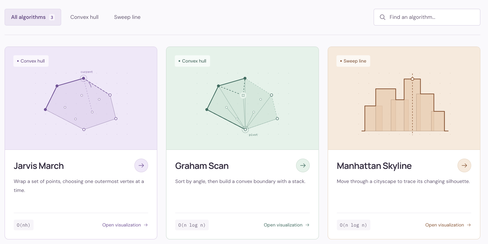

# Computational Geometry Visualisers


Step-by-step visualisations of computational geometry algorithms that run in the browser.
Each step shows what the algorithm is testing, what it decides, and why, so you can follow it one comparison at a time.

The algorithms are written in **Python** and run in the browser through [Pyodide](https://pyodide.org). The interface is a **React** app (Vite + Tailwind CSS) that draws whatever steps the Python code produces.

## Features

- **Jarvis march (gift wrapping)**, O(nh)
  - every orientation test is its own step, with the cross product value and the decision it leads to
  - the hull grows one confirmed point at a time and is closed in the final step
- **Graham scan**, O(n log n)
  - steps for choosing the start point, sorting by angle, every turn check and every stack pop
  - the stack is drawn as it grows and shrinks; popped points are explained (clockwise turn or collinear)
- **Algorithm library** to choose an algorithm, with a short description and its running time
- **Playback**: play/pause, adjustable speed, step forward and back, or drag the timeline
- **Inputs**: random points, best-case and worst-case presets, collinear and clustered sets, a point-count slider (5 to 35), or click to add your own points
- **Explanation panel** with the current step, its phase, the highlighted points, and how many orientation tests have been done so far
- **About the algorithm** tab with a description and pseudocode

The Manhattan skyline appears in the library, but its visualisation isn't available yet: the Python code computes the skyline area but doesn't produce steps.

## Controls

| Key | Action |
|-----|--------|
| `Space` | Play / pause |
| `→` | Next step |
| `←` | Previous step |
| `R` | Back to the first step |
| `?` | Show keyboard shortcuts |
| `Esc` | Close a dialog, stop adding points |
| `⌘K` / `Ctrl+K` | Search the algorithm library |

## Getting started

You need [Node.js](https://nodejs.org) (a recent LTS version).

```bash
git clone https://github.com/chrysalxsms/computational-geometry-visualisers.git
cd computational-geometry-visualisers/web
npm install
npm run dev
```

Open the link it prints (usually `http://localhost:5173`). The first time you open an algorithm it shows "Loading Python…" for a few seconds while Pyodide downloads, so an internet connection is needed.

Other commands, all run in `web/`:

```bash
npm run build     # build the site into web/dist
npm run lint      # check the JavaScript with ESLint
```

## How it works

```
Python algorithm  ──steps──▶  python.js (Pyodide)  ──JSON──▶  geometry.js  ──frames──▶  React UI
```

1. Each algorithm in `web/public/python/algorithms/` returns a list of **steps**. A step is a snapshot: the hull so far, the highlighted points by role (current, candidate, testing, popped, …), the lines to draw, and a sentence explaining the decision.
2. `web/src/python.js` starts Pyodide once, loads the `.py` files into it, and returns an algorithm's steps as JSON.
3. `web/src/geometry.js` converts each Python step into the frame format the interface draws (point ids, hull, highlighted points, phase).
4. The React components in `web/src/` only draw frames. They contain no algorithm logic.

Adding an algorithm means writing its step function in Python, registering it in `algorithms/registry.py`, and adding it to the list in `web/src/python.js`.

## Project structure

```
web/
  public/python/              the Python code, served to the browser
    algorithms/
      registry.py             maps algorithm names to their step functions
      jarvis.py               Jarvis march + step generator
      graham.py               Graham scan + step generator
      manhattan_skyline.py    sweep-line skyline area (no steps yet)
      chan.py                 placeholder for Chan's algorithm
    shared/
      geometry.py             cross product / orientation test
      points.py               random unique point generation
  src/
    python.js                 loads Pyodide and runs the Python algorithms
    geometry.js               turns Python steps into UI frames; presets and inputs
    App.jsx                   the visualisation workspace
    AlgorithmLibrary.jsx      the algorithm library page
main.py                       original pygame prototype (no longer runs, see below)
```

## Testing

The Python modules contain self-tests. Run them from `web/public/python/` with any Python 3:

```bash
cd web/public/python
python3 -m shared.geometry
python3 -m shared.points
python3 -m algorithms.jarvis
python3 -m algorithms.graham
python3 -m algorithms.manhattan_skyline
```

- **Jarvis march:** fixed cases plus 100 random point sets. It checks that no point lies outside the hull, that the steps end with the same closed hull, and that no step tests a point against itself.
- **Graham scan:** fixed cases (including points on edges and all-collinear input) plus 300 random point sets. It checks the hull against Jarvis march, that the steps end with the same closed hull, and that no popped point ends up on the hull.
- **Manhattan skyline:** the sweep is checked against a brute-force solution on 1000 random inputs.

## The pygame prototype

`main.py` is the original desktop version, built with pygame. It hasn't been updated since the Python code moved into `web/public/python/`, so it no longer runs. `requirements.txt` lists only what it needed (`pygame-ce`); the web app doesn't use it.

## Roadmap

- [x] Jarvis march with step-through
- [x] Graham scan
- [x] Web interface with the Python algorithms running in the browser
- [x] Algorithm library and selection
- [x] Autoplay with adjustable speed
- [ ] Show Graham's sort order and its own colours for each role (start, top, popped)
- [ ] Best- and worst-case inputs generated by the Python code
- [ ] Chan's algorithm
- [ ] Visualise the Manhattan skyline sweep
- [ ] Publish the site on GitHub Pages
