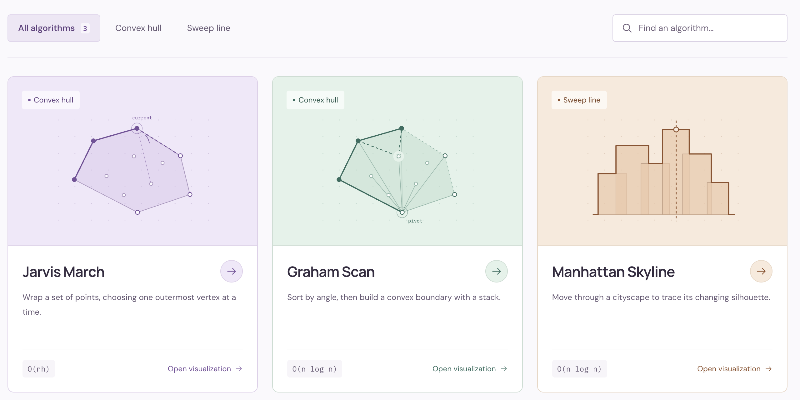

# Algeometry

Computational geometry algorithm visualisers

**▶ Try it: https://chrysalxsms.github.io/computational-geometry-visualisers/**


Step-by-step visualisations of computational geometry algorithms that run in the browser.
Each step shows what the algorithm is testing, what it decides, and why, so you can follow it one comparison at a time.

The algorithms are written in **Python** and run in the browser through [Pyodide](https://pyodide.org). The interface is a **React** app (Vite + Tailwind CSS) that draws whatever steps the Python code produces.

## Current Features

- **Jarvis march (gift wrapping)**, O(nh)
  - every orientation test is its own step, with the cross product value and the decision it leads to
  - the hull grows one confirmed point at a time and is closed in the final step
- **Graham scan**, O(n log n)
  - steps for choosing the start point, sorting by angle, every turn check and every stack pop
  - the stack is drawn as it grows and shrinks; popped points are explained (clockwise turn or collinear)
- **Algorithm library** to choose an algorithm, with a short description and its time complexity
- **Playback**: play/pause, adjustable speed, step forward and back, or drag the timeline
- **Inputs**: random points, best-case and worst-case presets, other specific presets according to algorithm performance.
- **Explanation panel** with the current step, its phase, the highlighted points, and how many orientation tests have been done so far
- **About the algorithm** tab with a description and pseudocode

## Controls

| Key             | Action                             |
| --------------- | ---------------------------------- |
| `Space`         | Play / pause                       |
| `→`             | Next step                          |
| `←`             | Previous step                      |
| `R`             | Back to the first step             |
| `?`             | Show keyboard shortcuts            |
| `Esc`           | Close a dialog, stop adding points |
| `⌘K` / `Ctrl+K` | Search the algorithm library       |

## How it works

```
Python algorithm  ──steps──▶  python.js (Pyodide)  ──JSON──▶  geometry.js  ──frames──▶  React UI
```

1. Each algorithm in `web/public/python/algorithms/` returns a list of **steps**. A step is a snapshot: the hull so far, the highlighted points by role (current, candidate, testing, popped, …), the lines to draw, and a sentence explaining the decision.
2. `web/src/python.js` starts Pyodide once, loads the `.py` files into it, and returns an algorithm's steps as JSON.
3. `web/src/geometry.js` converts each Python step into the frame format the interface draws.
4. The React components in `web/src/` only draw frames. They contain no algorithm logic.

## The pygame prototype

`main.py` is the original desktop version, built with pygame. It hasn't been updated since the Python code moved into `web/public/python/`, so it no longer runs. `requirements.txt` lists only what it needed (`pygame-ce`); the web app doesn't use it.

## Roadmap

- [x] Jarvis march with step-through
- [x] Graham scan
- [x] Web interface with the Python algorithms running in the browser
- [x] Algorithm library and selection
- [x] Autoplay with adjustable speed
- [ ] Show Graham's sort order and its own colours for each role (start, top, popped)
- [x] Best- and worst-case inputs
- [ ] Chan's algorithm
- [x] Visualise the Manhattan skyline sweep
- [x] Publish the site on GitHub Pages
- [ ] Bentley-Ottmann algorithm for determining the intersection of line segments
- [ ] Smallest enclosing disk
- [ ] kd-trees
- [ ] Voronoi Diagrams
